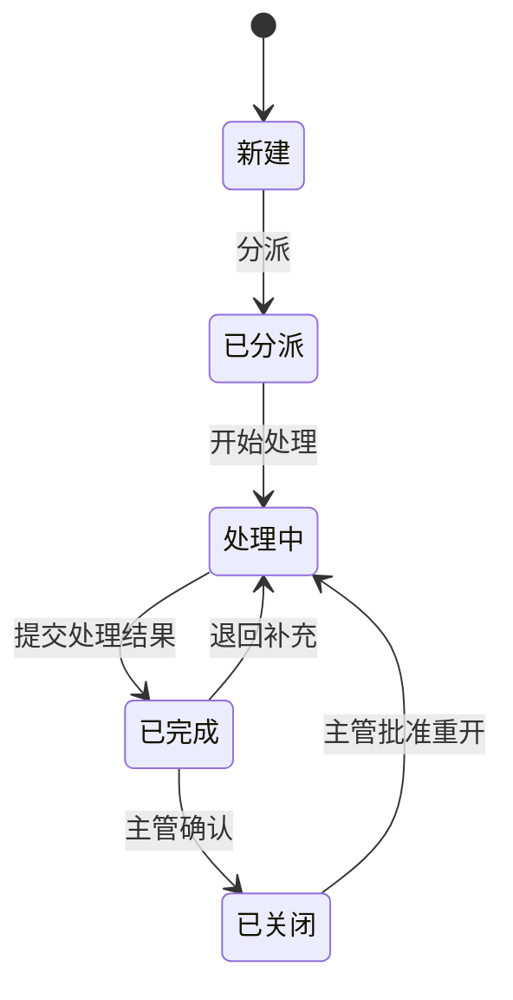

# CASE-01 参考分析与业务模型

以下为一组可讨论的教学参考，新增规则与决定均标为模拟协商结果。它们不是从原始材料自动推出的唯一答案。

## 问题与目标

问题：财务经办准备核对材料时需要跨页面复制并补充资产信息，当前材料缺少稳定的字段口径与快照说明。证据支持“存在这些工作与缺口”，尚不支持发生频率和平均损失的量化判断。

GOAL-01：降低授权园区财务经办准备核对材料时的人工整理负担，同时保持数据口径可解释、访问范围受控。是否改善需要基线与试点，不能预先填入实现效果。

首版范围建议：受控业务快照导出、数据缺失提示与字段补录协作。范围外：自动结算、不可变月度账本、向资产系统自动回写、跨园区越权汇总。

## 方案比较与教学决策

| 方案 | 可以改善 | 不能解决 / 依赖 | 教学决定 |
|---|---|---|---|
| 仅加强字段登记和现有手工流程 | 资产信息缺失 | 仍需复制，效果依赖执行 | 作为配套措施 |
| 受控导出加字段治理 | 减少复制，标出缺失 | 快照不等于结算记录 | DEC-01，首版候选 |
| 双向系统集成并自动结算 | 有机会减少跨系统操作 | 涉及更大数据责任、回写与审计范围 | 延后，需独立调研 |

DEC-01：在H03经案例角色讨论后，教学参考选择第二方案；业务负责人作为范围决策角色。现实项目必须真正完成确认，不能复制本条当作自己的批准记录。

## 模拟协商后的规则

| ID | 规则 | 来源与性质 |
|---|---|---|
| BR-01 | 数据按当前授权园区限制；申请、生成和下载都检查权限；下载时范围失效则拒绝整个文件并提示重新申请 | E03，控制细化为教学决定 |
| BR-02 | 月份按Asia/Shanghai；起点为选月1日00:00，终点为次月1日00:00，左闭右开 | E01月份诉求，具体口径为教学决定 |
| BR-03 | 导出以申请快照时刻为准，选择当时为已关闭且最近一次关闭时间在选月的工单 | E04、E06后协商的教学决定 |
| BR-04 | 主管可将已关闭工单重新打开为处理中；清空当前最近关闭时间，历史关闭事件另行保留；再次关闭时写入新的最近关闭时间 | E04支持需要，具体状态处理为教学决定 |
| BR-05 | 资产编号缺失保持为空，并标记missing_asset；禁止猜测补值；补录由业务协作处理 | E02、E05后的教学决定 |

## 工单状态

本模型只覆盖教学需要的状态子集；取消、挂起等未纳入本案例，不代表现实业务不需要。创建工单时必填site_id与ticket_id；asset_code可缺失，但要可见。普通经办不能直接将已完成改为已关闭。

## 数据与历史的解释

current_status是快照时的状态；latest_closed_at是当前最后一次关闭时间。重开后该字段为空，历史事件表仍保存原关闭事件。REQ-01不导出历史事件，不承担月度账本职责。

WO-106在11月3日申请的10月快照中不出现；若10月31日曾导出，它可能出现。两份文件的snapshot_at不同，因此不应被当成同一时点的结算账。界面和文件说明必须表达这一限制，否则功能可以通过测试却误导业务使用。

## 最小追踪链

GOAL-01 → E01/E02/E03/E05/E06 → H01/H02/H03 → DEC-01 → BR-01—BR-05 → REQ-01—REQ-04 → AC-01—AC-08 → 试点验证计划。

链中的箭头表示有理由的关联，不表示每个节点都是下一个节点的充分证据。证据不足的关系仍保留假设标记。
