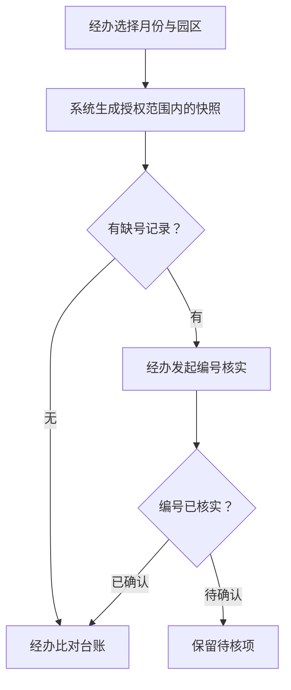

# A04 业务模型 · 参考样件与讲评

本样件给出一个课堂模型，标记观察步骤和模拟口径。学员可采用其他表述，但须能用同一输入解释各模型的结果。

## 第一课 · 补上缺号交接

| 位置 | 角色及动作 | 输出 | 依据与限制 |
|---|---|---|---|
| 起点 | 财务经办选择 10 月工单并复制列表 | 本地表格 | E02 单次观察 |
| 缺号分支 | 经办发现缺号，联系维修班组查询 | 编号查询交接 | E02。班组如何取得编号待查 |
| 观察终点 | 经办比对资产台账 | 已观察到比对动作 | E02 未跟踪后续审批与结算 |
| 补充异常 | 若未能查到，记录待核项并待接手 | 待核清单 | 课堂推演，实际责任人待定 |

候选目标流程可这样画。部署方式及是否进入首版由 M05 讨论。

候选改进是减少跨页面复制。查号仍需经办与班组或台账维护角色协作。缺号后挂起是候选处理。实际管理责任须核实。

## 第二课 · 状态与字段

| 原状态 | 事件与条件 | 下一状态 | 当前最近关闭时间及历史 |
|---|---|---|---|
| 处理中 | 班组提交处理结果 | 已完成 | 当前关闭时间为空 |
| 已完成 | 主管确认 | 已关闭 | 写入本次关闭时间，保留相应历史事件 |
| 已关闭 | 主管批准重开 | 处理中 | 清空当前最近关闭时间，原关闭事件留在历史 |
| 已完成 | 普通经办尝试直接关闭 | 保持已完成 | 拒绝动作，字段与历史不变 |
| 已关闭 | 未经批准尝试重开 | 保持已关闭 | 拒绝动作，字段与历史不变 |

以上非法操作结果为教学设计候选。工单当前状态和当前最近关闭时间来自申请时点的工单数据，历史事件用于复核。BR-02 对十月采用 Asia/Shanghai 的 10 月 1 日 00:00 含起点，11 月 1 日 00:00 不含终点。已获授权且状态合格的工单即使缺资产编号，也按 BR-05 保留，标记缺号。

业务对象为工单，最少保留工单标识、园区、当前状态、当前最近关闭时间和资产编号。历史事件与申请快照是用于解释它的两组关联记录。授权园区来自授权信息，申请时点来自申请记录。

| 场景 | 规则条件 | 结果 |
|---|---|---|
| 缺号但符合导出范围 | 已授权，申请快照时已关闭且时间在选月 | 保留该行，编号为空，标缺失。BR-03、BR-05 |
| 已生成文件，下载时权限失效 | 文件中的园区范围不再具备当前授权 | 拒绝整个文件并提示重新申请。BR-01 |
| 已授权、当前关闭时间在次月起点 | 计时采用 Asia/Shanghai，选此前一月 | 排除此行，即使当前为已关闭。BR-02、BR-03 |

## 第三课 · 走读 WO-106

| 申请时点 | 当前状态 | 当前关闭时间 | 十月业务快照结果 |
|---|---|---|---|
| 10 月 31 日 10:00 | 已关闭 | 10 月 30 日 16:00 | 在给定事件序列和授权假设下纳入 |
| 11 月 3 日 10:00 | 处理中 | 空 | 排除，原关闭事件仍留在历史 |

两个时点都是按规则推演。未据此认定 10 月 31 日实际产生过文件。「十月已结算工单」将时点快照说成已完成的结算。请财务经办提供历史复核使用的材料及用途，请业务负责人确认首版边界。若固定版本必需，要再讨论保存规则和责任。

按 [R3](02_评分量规.md) 讲评。模型发生矛盾时请学员用一条实例找出具体节点、字段或规则。能说明正常与异常、来源明确、同一工单走读相容，达到基本要求。再能用反例解释适用边界，并明确待确认事项，表现更稳健。
